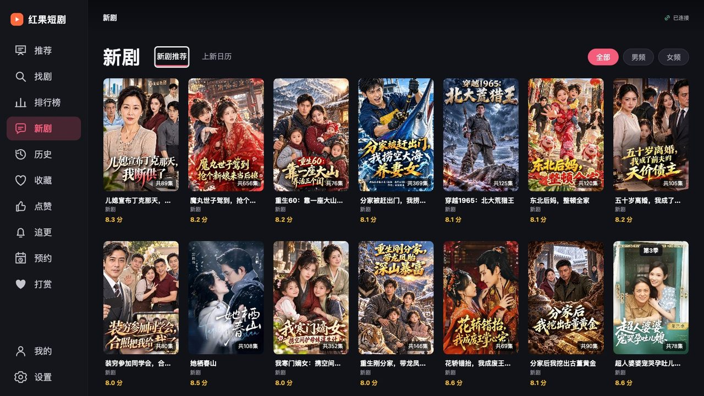
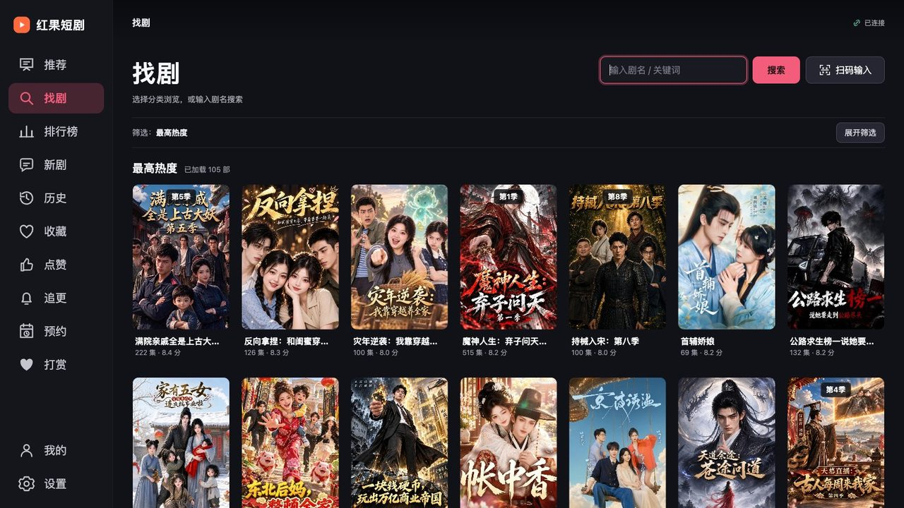
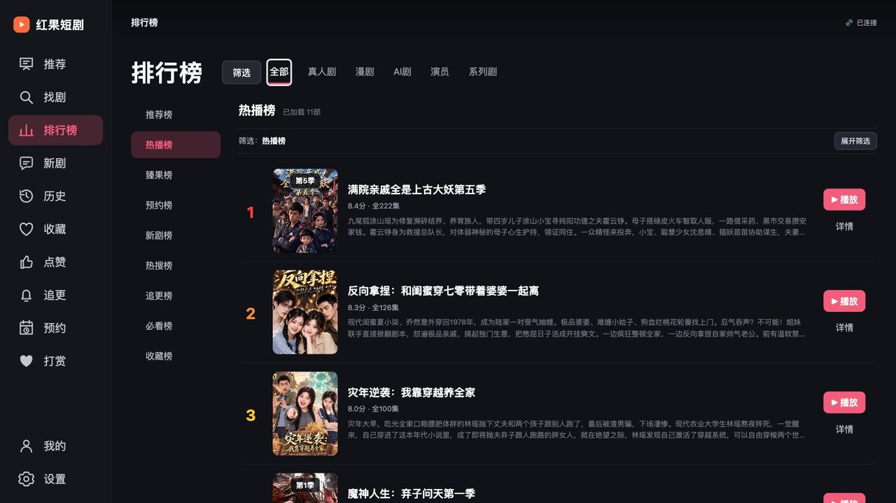

# 红果短剧下载（Android TV / webOS / macOS / Windows）

此仓库发布正式安装包、版本信息、更新说明和校验文件。MPV 库源码附件保留在私有源码仓库的 Release 中。

## 应用界面

<table>
  <tr>
    <td align="center"> 新剧推荐</td>
    <td align="center"> 搜索与海报浏览</td>
  </tr>
  <tr>
    <td align="center"> 热门榜单</td>
    <td align="center"> 选集与相关推荐</td>
  </tr>
</table>

- [Android TV 最新正式版本](https://github.com/aston314/hongguo-tv-releases/releases/latest)
- [LG webOS 测试版 `.ipk`](https://github.com/aston314/hongguo-tv-releases/releases/tag/webos-v0.2.78-test.2)
- [桌面版下载（macOS / Windows）](https://github.com/aston314/hongguo-tv-releases/releases/tag/desktop-v0.2.78)
- 面向 Android TV，最低 Android 6，支持 ARM64、ARMv7 和 x86_64。
- 从 0.2.7 起支持应用内检查更新；默认使用 ghfast 加速下载，失败时尝试直连。

## Android TV 下载哪个版本？

**首次安装，或现有版本能正常播放：选标准版。**

**标准版黑屏、只有声音或无法播放：再试 MPV 版。** 从 v0.2.50 起，MPV 版默认自动解码，优先尝试安全的硬件加速；可在 **“设置 → 播放解码”** 改为软件解码。软件解码对 CPU 性能要求更高，低性能盒子可能不够流畅，实际效果请在设备上测试。

打开 [最新正式版本](https://github.com/aston314/hongguo-tv-releases/releases/latest)，在 **Assets（附件）** 中选择：

| 版本 | 下载哪个 APK | 播放方式 |
| --- | --- | --- |
| **标准版** | **`hongguo-tv-版本号.apk`**（文件名不含 `mpv`） | WebView 播放，失败时使用 Media3 兼容回退 |
| **MPV 版** | **`hongguo-tv-mpv-版本号.apk`**（文件名含 `mpv`） | MPV 自动解码，可手动选择软件解码 |

例如 v0.2.52 的标准版是 `hongguo-tv-0.2.52.apk`；MPV 版是 `hongguo-tv-mpv-0.2.52.apk`。两个 APK 都支持 ARM64、ARMv7 和 x86_64，无需按设备架构另选安装包。

从 v0.2.51 起，两版安装后的名称统一为 **红果短剧**；请按原先安装的版本选择对应 APK，或使用应用内检查更新自动选择对应渠道。

### 已安装的用户怎么升级？

- **原来的红果短剧 → 下载标准版覆盖安装**，保留账号、观看记录和设置，无需卸载。
- **已安装 MPV 版 → 下载 MPV 版覆盖安装**，保留该版本的数据。
- **想测试 MPV → 直接安装 MPV 版**，可与标准版同时存在。MPV 版需要单独登录，本地记录和设置分别保存，不会替换原标准版。
- 两版各自检查对应更新渠道，应用内更新不会把标准版改装成 MPV 版。

**普通用户只需下载 `.apk`。** `update.json`、`update-mpv.json` 和 `SHA256SUMS.txt` 是更新或校验文件，均无需安装。MPV 库源码附件不在公开下载仓库中。

测试 MPV 时，建议用同一集比较自动解码和软件解码的流畅度，并检查连续切集、暂停恢复和音画同步。解码设置会保存，下次播放或切集时生效；自动模式画面异常时可改为软件解码后重新播放。异常时请提供应用内“播放诊断”的截图，诊断会显示实际解码路径和可用的掉帧信息。

## LG webOS 测试版

[下载 webOS 测试版](https://github.com/aston314/hongguo-tv-releases/releases/tag/webos-v0.2.78-test.2)，在 Release 的 **Assets** 中下载 `hongguo-webos-0.2.78-test.2.ipk`。这是 LG webOS TV 的实验包，不是 Android APK，也不属于稳定版。

安装需要在电视上启用 **LG Developer Mode**，并使用 webOS 开发工具安装 `.ipk`。目前已完成真实数据请求、签名、解密和本地媒体代理的文件级验证，尚未在 LG 真机验证安装、遥控焦点或视频播放；不同型号的 HEVC/AAC 支持可能不同，不能保证一定能播放。

测试反馈请附上 LG 电视型号、webOS 版本、安装/启动结果、播放画面和声音情况，以及具体错误现象。

## macOS / Windows 桌面版

[桌面版 0.2.78 下载](https://github.com/aston314/hongguo-tv-releases/releases/tag/desktop-v0.2.78)。无需安装 APK，选择对应平台的 ZIP：

| 平台 | 下载文件 | 要求 |
| --- | --- | --- |
| **macOS** | `hongguo-desktop-0.2.78-macos-universal.zip` | macOS 11 及以上，同包支持 Intel 和 Apple Silicon |
| **Windows amd64 / x64** | `hongguo-desktop-0.2.78-windows-x64.zip` | 64 位 Intel / AMD 处理器，需要 Microsoft Edge WebView2 Runtime |

macOS 解压后打开 **红果短剧.app**；Windows 请**完整解压整个文件夹**，打开 `红果短剧.exe`，保留 `hongguo-tv-core.exe` 在同一目录，不要单独启动核心程序。Windows 缺少 WebView2 时，请从 [微软官方页面](https://developer.microsoft.com/microsoft-edge/webview2/) 安装 Runtime。

桌面版使用系统 HTML5 播放，HEVC 视频是否能正常显示取决于系统与硬件。macOS 已实测真实播放和自动下一集，Windows 实体播放仍待实测。桌面版支持直接键盘输入和粘贴，不提供扫码输入。

### 桌面版怎么更新？

- 在 **设置 → 版本更新** 检查新版本，查看更新内容，点击 **下载更新 ZIP**。
- 每天后台检查一次；播放期间不弹出提醒。检查和下载优先使用 ghfast，失败后尝试直连。
- 下载显示进度，完成后核验大小、SHA256 和 ZIP 完整性；点击 **打开所在文件夹**。
- **安装由用户自己完成**：先退出应用，macOS 替换 `.app`；Windows 完整解压并替换程序文件夹，两个 EXE 必须一起更新。
- 账号、观看历史和设置保存在独立系统用户数据目录，正常替换程序不会删除这些数据。
- **0.2.60 及更早的桌面包需要手动下载一次 0.2.62 ZIP**。这次把应用文件改为“红果短剧”，旧更新器只识别英文路径，不能下载新的中文路径包。新版使用独立 `desktop-update-v2.json`，之后可在应用内下载更新。
- macOS 退出旧应用后，用 `红果短剧.app` 替换 `hongguo-desktop.app`；Windows 用新完整文件夹替换旧文件夹并打开 `红果短剧.exe`。账号、历史和设置目录保持不变。

桌面版使用独立的 `desktop-update-v2.json`，不会读取或替换 Android 标准版/MPV 更新渠道。`*.sha256` 和更新清单是校验/更新资料，无需安装。

当前没有 Apple 开发者签名/公证或 Windows 代码签名，系统可能显示未知开发者提示。

## 下载与更新

从 v0.2.52 起，左侧“我的”下方增加“设置”。检查更新在 **设置 → 版本更新**；MPV 版的解码选择和开源许可也移到设置中。旧版本升级前仍从“我的”检查更新。

国内网络可在 GitHub 文件链接前加 `https://ghfast.top/` 下载。

标准版使用 `update.json`，MPV 版使用 `update-mpv.json` 作为固定更新入口，各自只升级对应版本。每个 Release 提供两个 APK、两个更新清单和 `SHA256SUMS.txt`，用于核对下载文件。

MPV 版所需的 LGPL 库源码、依赖、许可声明、补丁及构建和替换工具随私有源码 Release 提供。使用 APK 无需下载源码附件；应用“设置 → 开源许可”也可离线查看许可信息。

还有，抖音（douyin）你会喜欢的：

- [看直播TV版](https://github.com/aston314/doudou-tv-releases/releases/latest)
